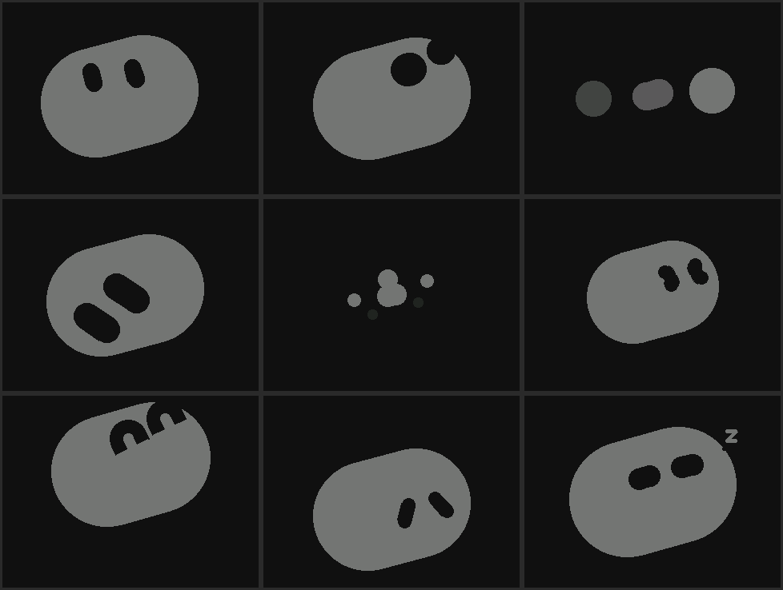

[English](features.md) | [中文](features.zh-CN.md) | [日本語](features.ja.md)

# Features

- **Expression engine**: the Grok Bot pill face. Nine Grok Bot states (idle, listening, thinking, working, waiting, blocked, done, failed, sleeping) follow what the agent is doing, reported by the gateway; the on-device moods (happy, sad, angry, surprised, dizzy, petting and more) use the same capsule shapes. Blinks, glances, swell, speech squash and 300 ms blended transitions are computed in `main/pill_face.hpp`.
- **AI voice conversation**: WebSocket connection to OpenAI Realtime, Google Gemini Live or a XiaoZhi server. Microphone audio goes up; reply audio drives the mouth. The half-duplex CoreS3 mutes the microphone while speaking; tap the screen or touch the head to interrupt a reply (barge-in).
- **Servo head motion**: SCS0009 yaw and pitch with a trapezoidal velocity profile.
- **Face tracking** (with the gateway on a Mac): the robot camera supplies frames over USB or Wi-Fi, Apple Vision finds your face, and the robot turns its head to follow it. Following pauses during conversation. Setup: [gateway README, Face tracking](../gateway/README.md#face-tracking).
- **Head touch**: Si12T three-zone capacitive touch (front, middle, back); stroking switches to the shy face (Affection).
- **Speech balloon**: reply text on a rounded white panel at the bottom of the screen; long text scrolls as a marquee.
- **Three setup paths**: BLE (NimBLE GATT), Wi-Fi STA (mDNS HTTP), SoftAP with a captive portal (iOS friendly).
- **OTA**: dual partitions with boot verification and rollback. Update over BLE in chunks, by local upload over Wi-Fi, or by letting the device fetch the matching board firmware from GitHub Pages.
