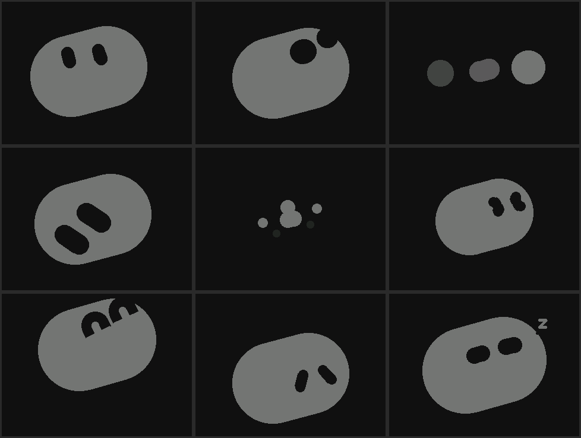

[English](features.md) | [中文](features.zh-CN.md) | [日本語](features.ja.md)

# 特性

- **表情引擎**：Grok Bot 胶囊表情。9 个 Grok Bot 状态（待机、聆听、思考、工作、等待、受阻、完成、失败、睡眠）随网关报告的智能体进度切换；本机心情（开心、难过、生气、惊讶、头晕、被摸头等）使用同一套胶囊形状。眨眼、扫视、呼吸、说话压扁和 300 ms 混合过渡由 `main/pill_face.hpp` 计算。
- **AI 语音对话**：WebSocket 连接 OpenAI Realtime、Google Gemini Live 或 XiaoZhi 服务器。麦克风上行，应答音频驱动口型；半双工的 CoreS3 在说话时关闭麦克风，应答中可以点屏幕或摸头顶打断（barge-in）。
- **舵机头部运动**：SCS0009 偏航加俯仰，梯形速度曲线。
- **人脸追踪**（网关运行在 Mac 上时）：Mac 摄像头追踪程序找到你的脸，网关让头跟着转；机器人说话或听你说话时暂停跟随。设置方法见[网关 README 的人脸追踪一节](../gateway/README.zh-CN.md#人脸追踪)。
- **头顶触摸互动**：Si12T 三区电容触摸（前、中、后）；抚摸切到害羞脸（Affection）。
- **气泡字幕**：屏幕底部白底圆角面板显示应答文本，长文跑马灯滚动。
- **三路配网**：BLE（NimBLE GATT）、Wi-Fi STA（mDNS HTTP）、SoftAP 加 captive portal（对 iOS 友好）。
- **OTA**：双分区写入，启动校验与回滚。可以经 BLE 分块写入、经 Wi-Fi 本地上传，或由设备从 GitHub Pages 拉取对应板卡的固件。
